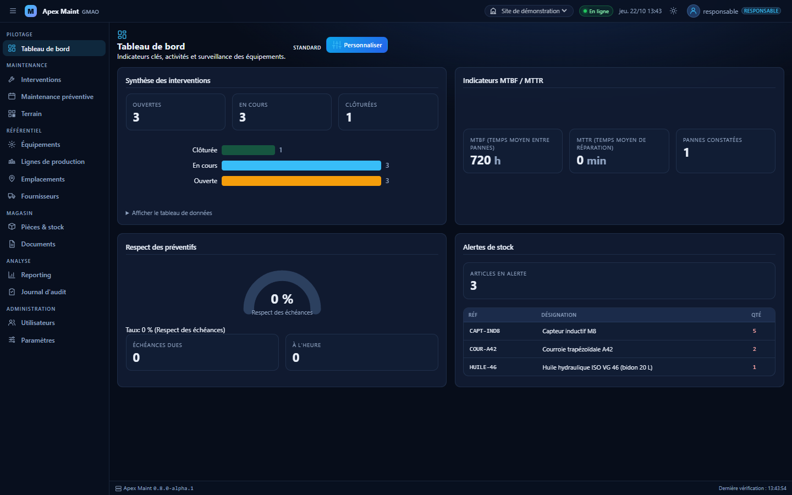
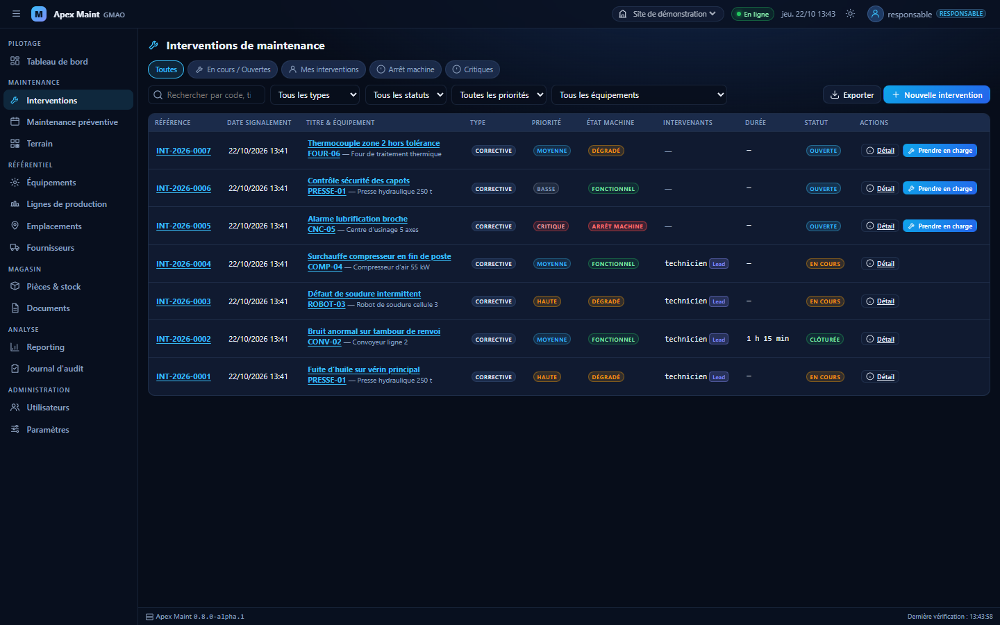
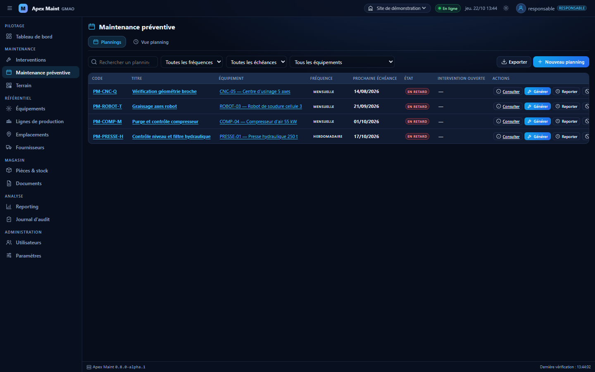
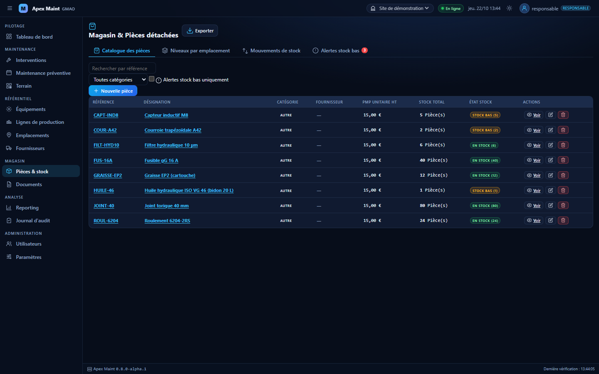
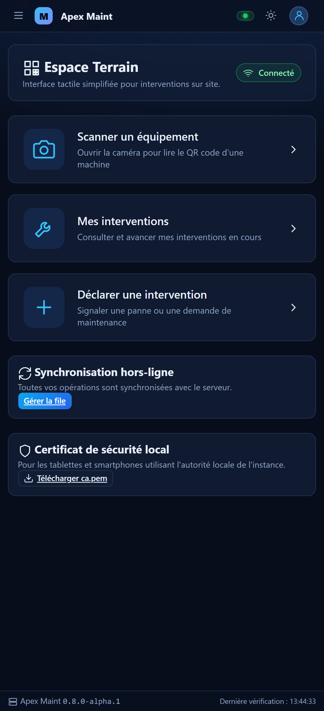
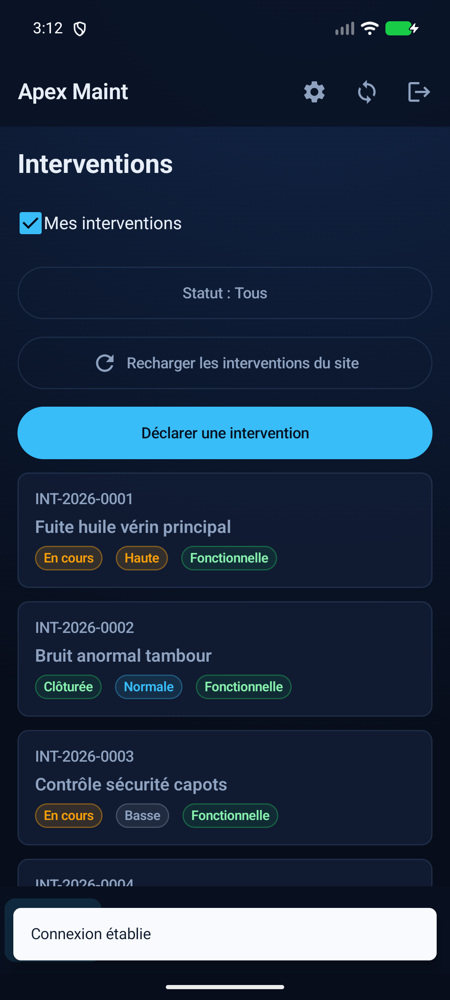
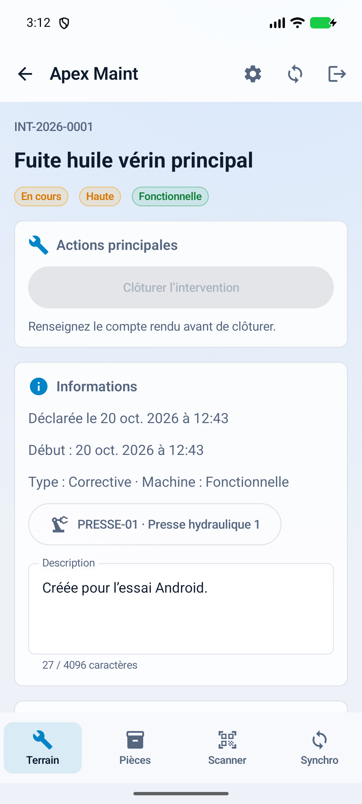
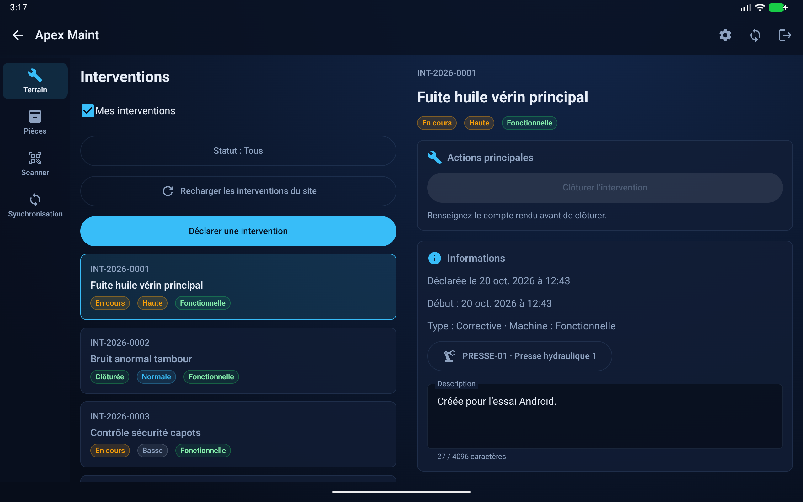
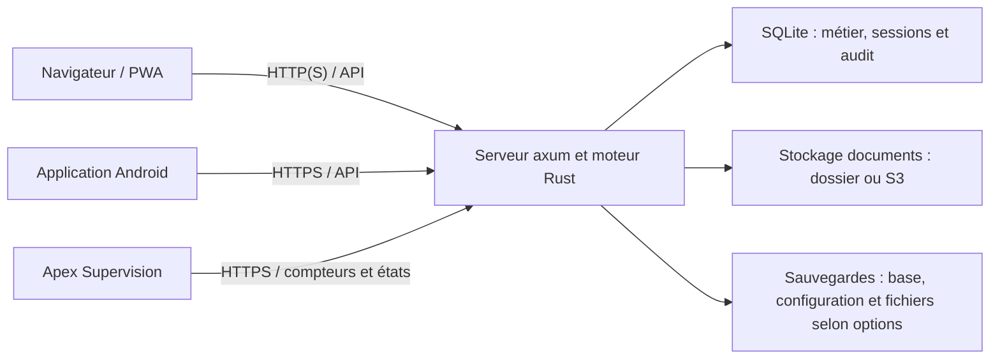

<div align="center">
  
  <p>La maintenance multi-sites, du pilotage aux interventions sur le terrain.</p>
  <p>
    <a href="LICENSE"></a>
    
    
    
    
  </p>
</div>

<picture>
  <source media="(prefers-color-scheme: light)" srcset="docs/images/web-tableau-de-bord-clair.png">
  <source media="(prefers-color-scheme: dark)" srcset="docs/images/web-tableau-de-bord-sombre.png">
  
</picture>

*Captures réelles d’une instance de démonstration. Les vues web suivent le thème du lecteur lorsque les deux variantes sont disponibles.*

## Sommaire

- [Présentation](#présentation)
- [Fonctionnalités](#fonctionnalités)
- [Application Android](#application-android)
- [Architecture](#architecture)
- [Démarrage rapide](#démarrage-rapide)
- [Installation](#installation)
- [Documentation](#documentation)
- [Développement](#développement)
- [Sécurité](#sécurité)
- [Contribution](#contribution)
- [Licence](#licence)

## Présentation

Apex Maint est une **GMAO multi-sites** (gestion de la maintenance assistée par ordinateur) écrite en Rust, avec une interface web et une application Android native. Elle réunit les équipes de maintenance et de production autour des équipements, des interventions et du stock de pièces.

Deuxième produit de la gamme **Apex**, elle reprend l’architecture et les conventions d’[Apex Supervision](https://github.com/kevin03L/Apex-Supervision). Les deux produits restent indépendants et peuvent échanger par API.

Le serveur est en version **`0.8.0-alpha.1`** : les phases 1 à 10 sont implémentées et des corrections d’audit se poursuivent. Les contrats HTTP et leurs limites sont documentés ci-dessous ; les évolutions sont recensées dans le [changelog](CHANGELOG.md).

## Fonctionnalités

| Domaine | Fonctions implémentées |
|---|---|
| **Maintenance** | Interventions correctives, préventives, a posteriori ou hors équipement ; priorités, état machine, affectation des techniciens, temps passé, compte rendu, sous-interventions et clôture. Préventif calendaire ou sur compteur, échéances, occurrences et génération d’interventions. |
| **Référentiel** | Sites, lignes de production, équipements en arborescence, emplacements hiérarchisés et fournisseurs. Documents versionnés rattachés aux équipements, interventions, pièces et plannings ; stockage en dossier ou compatible S3 ; QR codes et impression d’étiquettes. |
| **Magasin** | Catalogue, quantités par emplacement, entrées, sorties, transferts, ajustements, réservations et consommations liées aux interventions. Mouvements transactionnels, alertes de stock bas et valorisation. |
| **Pilotage** | Tableau de bord personnalisable, indicateurs MTBF/MTTR, arrêts, respect du préventif, coûts et temps de travail. Rapports, exports CSV/Excel/PDF selon le module, fiche d’intervention PDF et notifications SMTP configurables. |
| **Terrain et hors ligne** | Interface web tactile et PWA installable, scan de QR code, cache local, file persistante des opérations d’intervention et gestion des conflits à la reconnexion. Client Android pour téléphone et tablette. |
| **Exploitation** | Mode portable, service Windows ou unité systemd, utilitaire graphique `apex-maint-admin`, installateur Windows et paquets DEB amd64/arm64. Sauvegardes à chaud, restauration moteur arrêté, rétention, purge et vérification des fichiers. TLS direct ou proxy HTTPS. |
| **Sécurité** | Rôles Administrateur, Responsable, Production et Technicien ; matrice de permissions, isolation par site, suppression logique des données métier, sessions révocables et journal d’audit. |

La **liaison facultative avec Apex Supervision** reçoit les compteurs et les états d’équipement via des clés de service limitées à un site. Les compteurs alimentent le préventif ; les états sont affichés à titre informatif, sans création automatique d’intervention corrective. Voir le [contrat d’intégration](docs/integration-supervision.md).

### Galerie web

<table>
  <tr><th width="50%">Interventions et priorités</th><th width="50%">Maintenance préventive</th></tr>
  <tr>
    <td><picture><source media="(prefers-color-scheme: light)" srcset="docs/images/web-interventions-clair.png"><source media="(prefers-color-scheme: dark)" srcset="docs/images/web-interventions-sombre.png"></picture></td>
    <td><picture><source media="(prefers-color-scheme: light)" srcset="docs/images/web-preventif-clair.png"><source media="(prefers-color-scheme: dark)" srcset="docs/images/web-preventif-sombre.png"></picture></td>
  </tr>
  <tr><th>Pièces et stock</th><th>Espace Terrain sur téléphone</th></tr>
  <tr>
    <td align="center"><picture><source media="(prefers-color-scheme: light)" srcset="docs/images/web-pieces-clair.png"><source media="(prefers-color-scheme: dark)" srcset="docs/images/web-pieces-sombre.png"></picture></td>
    <td align="center"><a href="docs/images/web-terrain-mobile.png"></a></td>
  </tr>
</table>

## Application Android

Le client natif **Kotlin et Jetpack Compose** utilise la même API que le web, sur **Android 8.0 / API 26 minimum**. Il propose les interventions terrain, la déclaration, le scan de QR code, le catalogue des pièces et les documents. Les thèmes clair et sombre sont disponibles, avec une présentation liste/détail sur deux volets pour les grandes tablettes.

Après synchronisation, le cache Room et la file locale permettent de créer, prendre en charge, modifier et clôturer une intervention, ainsi que de saisir son temps hors ligne. La synchronisation contrôle les doublons et les conflits. Les documents, photos et sorties de pièces nécessitent le réseau. Les données locales sensibles sont chiffrées avec une clé Android Keystore.

<table>
  <tr><th width="25%">Téléphone · sombre</th><th width="25%">Téléphone · clair</th><th width="50%">Tablette · deux volets</th></tr>
  <tr>
    <td valign="top"><a href="docs/images/android-telephone-sombre.png"></a></td>
    <td valign="top"><a href="docs/images/android-telephone-clair.png"></a></td>
    <td valign="top"><a href="docs/images/android-tablette.png"></a></td>
  </tr>
</table>

La version de l’application Android est actuellement `0.1.0`, distincte de celle du serveur. Les prérequis, la compilation, la configuration HTTPS et les limites de validation de la dernière révision sont détaillés dans [android/README.md](android/README.md).

## Architecture

Un seul processus Rust réunit le moteur métier et le serveur HTTP **axum**. L’interface web est statique, sans framework ni étape de build ; SQLite est embarquée et les documents sont stockés séparément.



La PWA utilise un cache IndexedDB et l’application Android un cache Room. Le serveur contrôle les droits à chaque requête. Apex Supervision conserve sa propre base ; la liaison passe exclusivement par l’API de Maint.

## Démarrage rapide

Pour le développement en mode portable, prérequis : **Rust 1.95 ou plus récent** (notamment pour l’utilitaire graphique).

```bash
cargo build
target/debug/apex-maint config init --portable --demo   # crée ./apex-maint.toml
target/debug/apex-maint run                             # Ctrl+C pour arrêter proprement
```

Sous Windows, le binaire porte l’extension `.exe`. L’IHM web est disponible sur <http://localhost:3100> ; le serveur écoute sur `127.0.0.1` par défaut. Apex Supervision utilise le port `3000`.

Au premier démarrage, le compte **`admin` / `admin123`** est créé. **Le changement de ce mot de passe est obligatoire avant d’accéder aux fonctions d’administration.** Le site « Site principal » est créé si aucun site n’existe.

Avec `config init --demo` (qui active `[demo] enabled = true`), les comptes suivants sont créés une seule fois sur le « Site de démonstration » :

| Compte | Mot de passe |
|---|---|
| `responsable` | `demo1234` |
| `technicien` | `demo1234` |
| `production` | `demo1234` |

Réservez cette option aux instances de démonstration. Pour les tests et la recette, utilisez uniquement des **instances portables temporaires sur des ports autres que 3000 et 3100**, sans données d’exploitation ; changez le port dans la configuration avant le lancement.

## Installation

Les procédures sont dans le [guide d’installation](docs/INSTALLATION.md). Les sources de packaging sont disponibles dans [packaging/](packaging/) :

- **Windows** : [script de construction Inno Setup 6](packaging/windows/build-installer.ps1), service `ApexMaint` et utilitaire d’administration. La signature Windows reste désactivée dans la procédure documentée.
- **Debian / Ubuntu** : [construction des DEB natifs amd64 et arm64](packaging/linux/build-deb.sh), unité systemd et lanceur de l’utilitaire. Le paquet ne démarre pas le service sans configuration.

Pour les sauvegardes, restaurations et opérations de maintenance, consultez le [guide d’administration](docs/ADMINISTRATION.md). Aucune reprise des données de l’ancienne GMAO n’est prévue.

## Documentation

| Document | Contenu |
|---|---|
| [Installation](docs/INSTALLATION.md) | Installation Windows/Linux, comptes initiaux et chemins des données. |
| [Administration](docs/ADMINISTRATION.md) | Utilitaire, sauvegarde, restauration, purge et contrôle des fichiers. |
| [Plan d’architecture](docs/PLAN.md) | Architecture et feuille de route historique ; décisions et contrats précisent les choix réalisés. |
| [Intégration Supervision](docs/integration-supervision.md) | Contrat d’échange des compteurs et états par clé de service. |
| [API phase 4](docs/API-PHASE-4.md) | Idempotence des sorties de pièces et consommations de réservations. |
| [API phase 6](docs/API-PHASE-6.md) | Documents versionnés, stockages, QR et étiquettes. |
| [API phase 7](docs/API-PHASE-7.md) | Tableaux de bord, rapports, exports, audit et paramètres. |
| [API phase 8](docs/API-PHASE-8.md) | Exploitation, sauvegardes et archives. |
| [API phase 9](docs/API-PHASE-9.md) | Instantanés terrain, synchronisation et TLS. |
| [API phase 10](docs/API-PHASE-10.md) | Routes d’ingestion et gestion de la liaison Supervision. |
| [Décisions](docs/specs/decisions.md) | Arbitrages fonctionnels et techniques des phases 5 à 10. |
| [Spécification phase 1](docs/specs/phase-1.md) | Authentification, sites, utilisateurs et permissions. |
| [Spécification phase 2](docs/specs/phase-2.md) | Équipements, lignes, emplacements et fournisseurs. |
| [Spécification phase 3](docs/specs/phase-3.md) | Interventions, affectations et cycle de traitement. |
| [Spécification phase 4](docs/specs/phase-4.md) | Pièces, stock, mouvements et réservations. |
| [Spécification phase 5](docs/specs/phase-5.md) | Préventif, compteurs et échéances. |
| [Spécification phase 6](docs/specs/phase-6.md) | Gestion documentaire et identification par QR code. |
| [Spécification phase 7](docs/specs/phase-7.md) | Pilotage, exports, notifications et réglages. |
| [Spécification phase 8](docs/specs/phase-8.md) | Services, packaging et maintenance de l’instance. |
| [Spécification phase 9](docs/specs/phase-9.md) | Parcours terrain, PWA, hors ligne et HTTPS. |
| [Spécification phase 10](docs/specs/phase-10.md) | Liaison facultative entre les produits Apex. |
| [Application Android](android/README.md) | Construction, connexion, écrans, hors ligne et recette mobile. |
| [Audit Android](android/AUDIT.md) | Constats, corrections et résultats de validation du client natif. |

## Développement

Les règles du dépôt sont dans [AGENTS.md](AGENTS.md) et le [guide de contribution](CONTRIBUTING.md). Depuis la racine :

```bash
cargo fmt --all
cargo clippy --workspace --all-targets -- -D warnings
cargo test --workspace
```

Contrôle JavaScript de **tous** les fichiers `static/*.js` (un fichier par appel à `node --check`) :

```powershell
Get-ChildItem static/*.js | ForEach-Object { node --check $_.FullName; if ($LASTEXITCODE -ne 0) { throw "Syntaxe JavaScript invalide" } }
```

Sous un shell POSIX :

```sh
for f in static/*.js; do node --check "$f" || exit; done
```

Les vérifications complémentaires définies dans le [workflow](.github/workflows/ci.yml) incluent `cargo fmt --all --check` et `node --test tests/*.test.js`. Les GitHub Actions ne tournent pas actuellement ; les badges ci-dessus décrivent les prérequis et la version, sans résultat de CI.

## Sécurité

Les sessions web utilisent un cookie **`HttpOnly`**, **`SameSite=Strict`**, inaccessible au JavaScript. Elles expirent après l’inactivité définie par `[security] session_ttl_hours` (12 heures par défaut). Activez `secure_cookie = true` derrière HTTPS. Les changements de droits, désactivations, suppressions et réinitialisations de mot de passe révoquent les sessions concernées.

Les mots de passe sont hachés avec Argon2id. Les rôles et permissions sont contrôlés côté serveur, avec filtrage par site et journal d’audit des modifications. Pour signaler une vulnérabilité de manière privée, suivez [SECURITY.md](SECURITY.md).

## Contribution

Les signalements de bogues et propositions d’évolution passent par les formulaires du dépôt. Pour préparer une contribution, consultez [CONTRIBUTING.md](CONTRIBUTING.md), les spécifications et les contrats du module concerné.

## Licence

Apex Maint est distribué sous licence **GPL-3.0-or-later** (GNU General Public License version 3 ou ultérieure). Le texte intégral figure dans [LICENSE](LICENSE).

Copyright © 2026 kevin03L.
